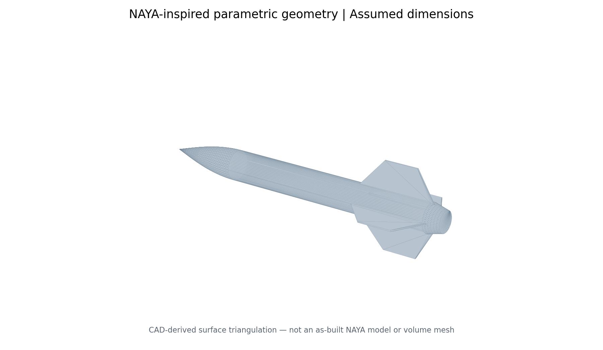

# NAYA | Rocket Aerodynamics and Numerical Flow Modelling

> **Independent engineering portfolio extension · 2026 · James Bourke**  
> **Research status:** geometry = assumed concept; numerical plots = newly computed **2-D inviscid potential-flow surrogate**; 3-D OpenFOAM RANS case = **unrun, unvalidated starter template**.



## Project summary

This repository adapts the computational engineering process used in my SEM400 computational fluid dynamics coursework to a **NAYA-inspired rocket-shaped geometry**. It shows parametric modelling, pre-processing, numerical solution, results interpretation, and a documented path toward three-dimensional external aerodynamics analysis.

**Important provenance statement:** this is a **new portfolio study**. It is not a recovered ANSYS Fluent project, is not an original SEM400 assignment submission, and does not reproduce the final physical CAD of Project NAYA. The original NAYA capstone concerned a **suspended thrust-vector-control demonstrator**; the imposed external freestream here is a separate hypothetical scenario, not a flight or powered-bench operating condition.

## At a glance

| Item | Status | Interpretation |
|---|---|---|
| Rocket length | 0.885 m, from prior project summary | Only confirmed overall dimension used here; verify against as-built CAD |
| Body radius, nose, four fins | **Assumed** in `scripts/model.py` | Educational concept, not measured NAYA dimensions |
| Surface CAD model and `.stl` | **Generated**; watertightness checked | Useful as a meshing starting point |
| 2-D flow, speed, and $C_p$ images | **Computed** with an original finite-volume Laplace solver | Inviscid potential flow only; **not** turbulent viscous CFD |
| Surrogate mesh sensitivity | **Computed** at four resolutions | Grid-independence has **not** been established |
| OpenFOAM `simpleFoam` / SST case | **Configured only** | Not executed or validated in this environment |
| Drag, lift, stability derivatives, powered-flow interaction | **Not determined** | Requires verified 3-D RANS and/or experimental data |

## Visual results (preliminary, inviscid 2-D model)

| Velocity magnitude | Ideal-flow streamlines |
|---|---|
|  |  |


The model solves $\nabla^2\phi=0$ for the velocity potential $\phi$, with impermeability at a stair-stepped rocket-shaped internal boundary. Fluid velocity is calculated as $\mathbf{u}=\nabla\phi$, and the idealized pressure coefficient is $C_p=1-|\mathbf{u}|^2/U_\infty^2$. It can show **how the assumed shape redirects flow**, but cannot resolve viscous separation, turbulent wakes, boundary layers, aerodynamic drag, three-dimensional fin interference or thrust exhaust.

**Interpretation:** higher ideal-flow speeds near the fin tips and reduced speeds at the front/aft of the profile are results of the model's boundary-value problem—not evidence that the real rocket has the depicted flow structure. In particular, the near-symmetric idealized aft flow is **not a physical prediction of the real wake**.


The example grid spans **12,800–80,000 rectangular background cells**. At the selected off-body probe, $C_p$ changes from about **−0.0044 to +0.0237** across these runs. Because the sampled quantity is **still changing**, this does **not** demonstrate grid convergence or mesh independence. The algebraic solver's relative residual is about $10^{-9}$ for each case; **equation-solver convergence is not grid convergence or experimental validation**.

## Working assumptions (editable)

| Parameter | Value | Provenance |
|---|---:|---|
| Overall length | 885 mm | Existing project summary; not verified from original CAD |
| Body diameter | 90 mm | **Assumed** |
| Nose length | 210 mm | **Assumed** |
| Fin count | 4 | **Assumed** |
| Max fin radius from centreline | 135 mm | **Assumed** |
| Freestream speed for visualisation | 15 m/s | **Assumed**, not a NAYA measured airspeed |
| Air density | 1.225 kg/m³ | Standard illustrative assumption |
| Kinematic viscosity | $1.5\times10^{-5}$ m²/s | Standard illustrative assumption |

For $U_\infty=15$ m/s and these assumptions, dynamic pressure is **137.8 Pa** and Reynolds number based on overall length is **$8.85\times10^5$**. These are **dimensional calculations**, not CFD-computed loads.

## Repository layout

```text
NAYA-Rocket-Aerodynamics/
├── README.md
├── LICENSE                     # MIT for scripts / OpenFOAM case configurations
├── LICENSE-DOCS.md             # CC BY 4.0 for new docs, figures, results, STL
├── NOTICE.md                   # Scope of rights and provenance
├── CITATION.cff
├── geometry/
│   ├── naya_concept.stl        # new watertight assumed geometry
│   └── naya_concept.json       # parameters + source classification
├── figures/                    # generated images with prominent limitations
├── results/                    # numerical metadata, grid sensitivity, estimates
├── scripts/                    # fully readable source and rebuild tools
├── tests/                      # solver and geometry checks
├── openfoam/naya_external/     # UNVERIFIED 3-D RANS case starter
└── docs/                       # methodology, validation, publication controls
```

## Quick start (Python)

Python 3.10+ recommended. From this repository root:

```bash
python3 -m venv .venv
source .venv/bin/activate
pip install -r requirements.txt

# Generate 2-D actual numerical potential-flow visualisations
python scripts/potential_flow_2d.py --nx 400 --ny 200 --u 15

# Produce derived dimensional checks
python scripts/flow_estimates.py

# Run basic quality checks
python -m pytest -q
```

The STL is **already included**, so CadQuery is not required just to view the repository. Rebuilding 3-D geometry from scratch needs the optional `cadquery` dependency:

```bash
pip install -r requirements-cad.txt
python scripts/generate_geometry.py --output geometry/naya_concept.stl --check
python scripts/create_openfoam_case.py
python scripts/make_portfolio_figures.py
```

For the **unverified OpenFOAM starter**, see [`docs/reproduce.md`](docs/reproduce.md) and [`openfoam/naya_external/Allrun`](openfoam/naya_external/Allrun). The case targets an **OpenFOAM.com-style `simpleFoam` workflow** with `snappyHexMesh` and $k$–$\omega$ SST; different distributions may require field/dictionary changes. **No OpenFOAM solver or mesher was available when this repository was assembled**, so the case has not passed an actual CFD run.

## Engineering workflow adapted from SEM400

In SEM400, the computational workflow included a wing/far-field domain, meshing with inflation layers, pressure far-field conditions, turbulence-model selection ($k$–$\omega$ SST), grid independence and comparison against a reference workshop. Here the **methodology** is transferred, rather than its original CFD data: see [`docs/SEM400_to_NAYA.md`](docs/SEM400_to_NAYA.md).


**Next CFD verification gates:** ensure the external surface and fin thickness are resolved; check mesh-quality reports, near-wall $y^+$ and inflation; monitor solver continuity and force convergence; run at least three systematically refined meshes; test freestream/far-field sensitivity; vary angle of attack; validate against an independent experiment, benchmark or established reference. See [`docs/methodology.md`](docs/methodology.md) and [`docs/verification_validation.md`](docs/verification_validation.md).

## Limitations and ethics

This is not a free-flight stability analysis and is not an operating guide for rocket control hardware. It contains no confidential employer files, original Deakin-provided templates, private test logs or independently owned photographs. A manual intellectual-property and attribution check is still required before public release. **Do not describe surrogate figures as Fluent, ANSYS, OpenFOAM, Reynolds-averaged Navier–Stokes (RANS) or measured results.**

## Authorship and licensing

Copyright © 2026 **James Bourke**, for original material in which he owns the rights, subject to any applicable collaborator or third-party rights. New repository code and CFD dictionaries: **[MIT](LICENSE)**. New original documentation, figures, numeric tables and concept geometry: **[Creative Commons Attribution 4.0 International](LICENSE-DOCS.md)**. Both allow reuse subject to their terms. See [`NOTICE.md`](NOTICE.md) and [`docs/public_release_checklist.md`](docs/public_release_checklist.md).

This is an independent student/alumni portfolio project, **not endorsed by Deakin University or an employer**.

### Technical references

- [OpenFOAM.com — `snappyHexMesh` overview](https://doc.openfoam.com/2606/tools/pre-processing/mesh/generation/snappyhexmesh/)
- [OpenFOAM.com — `simpleFoam` incompressible steady RANS solver](https://doc.openfoam.com/2306/tools/processing/solvers/rtm/incompressible/simpleFoam/)
- [OpenFOAM.com — solver settings and SIMPLE controls](https://www.openfoam.com/documentation/user-guide/6-solving/6.3-solution-and-algorithm-control)
- [Deakin University — Student intellectual property](https://www.deakin.edu.au/students/research-support/policies-and-procedures/intellectual-property)
