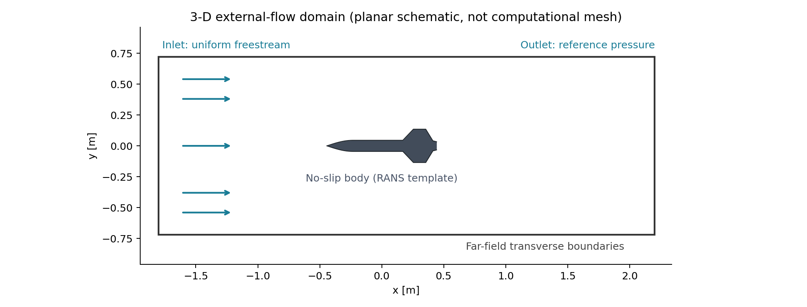

# Methodology: numerical model and planned three-dimensional CFD

## Research scope

Examine external subsonic freestream flow around an **illustrative NAYA-inspired geometry**. This is **not** the actual operating environment of the original suspended thrust-vector-control bench demonstrator.

## Geometry and coordinate system

- Nose direction: negative x; nominal incoming air travels in +x.
- Overall length: 0.885 m (from prior project summary, not remeasured here).
- Diameter 0.090 m, fin count 4, fin positions/chords and nose profile: **all assumed** and editable in [`scripts/model.py`](../scripts/model.py).
- The new surface `.stl` is checked watertight; this does not prove surface quality or mesh readiness.

## Stage A: completed educational finite-volume potential flow

The Python code solves the Laplace equation for an ideal 2-D velocity potential:

\[ \nabla^2\phi=0, \qquad \mathbf{u}=\nabla\phi, \qquad C_p=1-\frac{\lVert\mathbf{u}\rVert^2}{U_\infty^2}. \]

Cell-centred finite-volume discretisation with internal no-normal-flux faces and a uniform-potential outer Dirichlet field is solved using preconditioned conjugate gradients. The 2-D mask approximates an opposite-fin cross-section; it is **not a slice from 3-D simulation**. Graphs exclude a narrow band near stair-stepped walls because gradient recovery there is not reliable.

Assumptions: inviscid, incompressible, steady, irrotational, two-dimensional. The output **cannot** resolve drag, turbulent boundary layers, flow separation, exhaust effects or physical rocket stability.

## Stage B: prepared but unrun 3-D SST RANS workflow

| Setting | Current starter | Why it matters |
|---|---|---|
| Solver | OpenFOAM.com-style `simpleFoam` / SIMPLE | Steady incompressible RANS, **not run here** |
| Turbulence | SST k–ω | Requires appropriate wall resolution and inlet turbulence scales |
| Fluid | Density 1.225 kg/m³ for force reporting; ν=1.5e−5 m²/s | Chosen conventional air assumptions |
| U | 15 m/s axial | Hypothetical speed, not measured |
| Domain | x∈[−1.8,2.2] m, y,z∈[−0.72,0.72] m | Check sensitivity of far-field placement |
| Mesher | `blockMesh` → `surfaceFeatureExtract` → `snappyHexMesh` | Thin assumed fins may be inadequately captured |
| Inflation | Off in starter | **Must be designed before trusting shear or drag** |
| Output | `forces` functionObject configured | Must check sign, reference point and convergence after actual run |

## Proposed verification and validation plan

1. Check triangulation, self-intersections and fin-thickness resolution; review STL surface normals and OpenFOAM patch assignment.
2. Execute `checkMesh`; review non-orthogonality, skewness, cell coverage, bad-quality cells and minimum volume.
3. Design near-wall layers for chosen SST treatment, solve, and inspect calculated y+ distribution.
4. Examine mass flux balance, scaled residuals and histories of forces/moments, not residuals alone.
5. Run coarse/medium/fine 3-D grid and perform quantitative force/pressure comparisons; do not claim grid independence prematurely.
6. Vary domain dimensions to check far-field interference.
7. Set up 0°, 5° and 10° incidence, with correct velocity components and reference axes.
8. Validate selected results against trusted experimental or benchmark data and account for uncertainty.

Expected later outputs include aerodynamic drag, normal force, pitching/yawing moments and coefficient-versus-incidence curves. **None of those 3-D coefficients have been computed in this repository.**

Official references: [OpenFOAM snappyHexMesh](https://doc.openfoam.com/2606/tools/pre-processing/mesh/generation/snappyhexmesh/), [simpleFoam](https://doc.openfoam.com/2306/tools/processing/solvers/rtm/incompressible/simpleFoam/).
