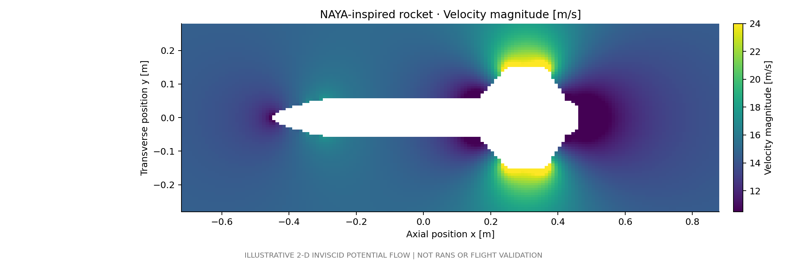
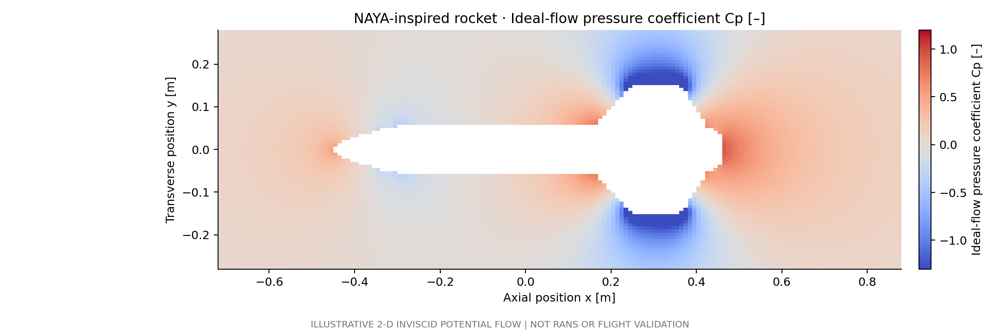
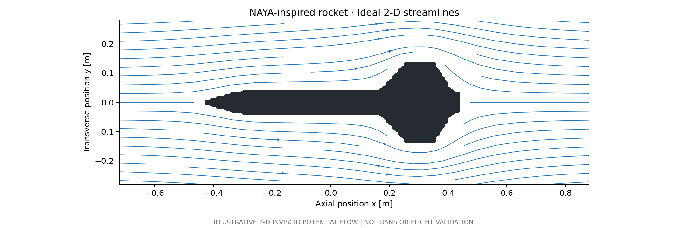
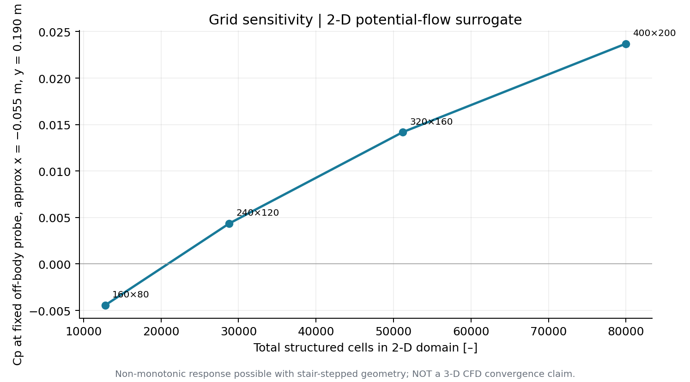

# Preliminary results and interpretation

**Every included numerical value was generated in this new repo.** There are **no historic Fluent or NAYA hardware data**, and the OpenFOAM 3-D RANS case has **not been run**.

## Computed velocity and pressure coefficient

The inviscid 2-D solution shows local acceleration around the new assumed fin silhouette, with slower flow near fore/aft stagnation-like regions. The pressure coefficient is computed from an ideal Bernoulli model, not from 3-D Navier–Stokes equations. The idealized aft flow is **not** a prediction of a real separated turbulent wake.

## Computed streamlines

These lines are trajectories integrated through computed ideal 2-D velocities—not smoke testing, a 3-D solution, or a free-flight prediction.

## Grid sensitivity: NOT independent

At background grid sizes of **12,800, 28,800, 51,200 and 80,000** cells, off-body probe $C_p$ changes as follows: **−0.00443, +0.00436, +0.01419, +0.02371**. The trend has not converged. The CG algebraic residual of approximately 1e−9 indicates the linear system was solved; it does **not** demonstrate discretisation convergence or real-world validity. The solid is approximated as a staircase and the geometry representation itself changes with grid size.

Raw files: [`results/grid_sensitivity_surrogate.csv`](../results/grid_sensitivity_surrogate.csv), [`potential_flow_metadata.json`](../results/potential_flow_metadata.json).

## Hypothetical dimensional scaling

[`dimensional_estimates.csv`](../results/dimensional_estimates.csv) contains arithmetic for q, Mach and Reynolds numbers at assumed 5/15/30 m/s speeds. For **15 m/s**, q = **137.81 Pa** and $Re_L = 8.85\times 10^5$ under assumed air properties. **These are not predicted aerodynamic loads.**

## Claims not supported

No physical NAYA drag, $C_D$, lift, pitching moments or flight stability; no CFD/bench correlation; no actual 3-D OpenFOAM fields; no validated NAYA geometry; no proof of aerodynamic grid convergence.
